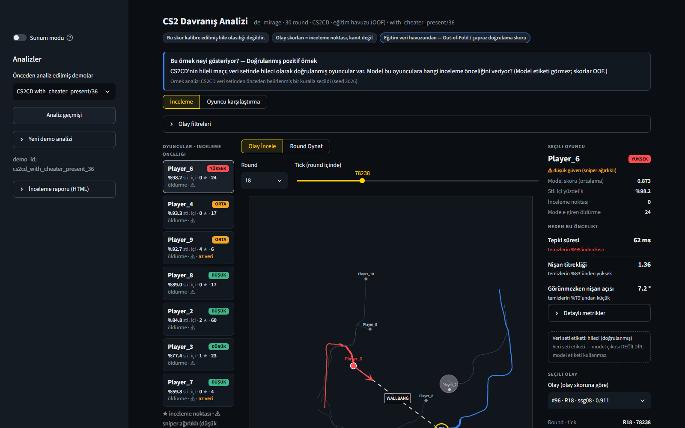
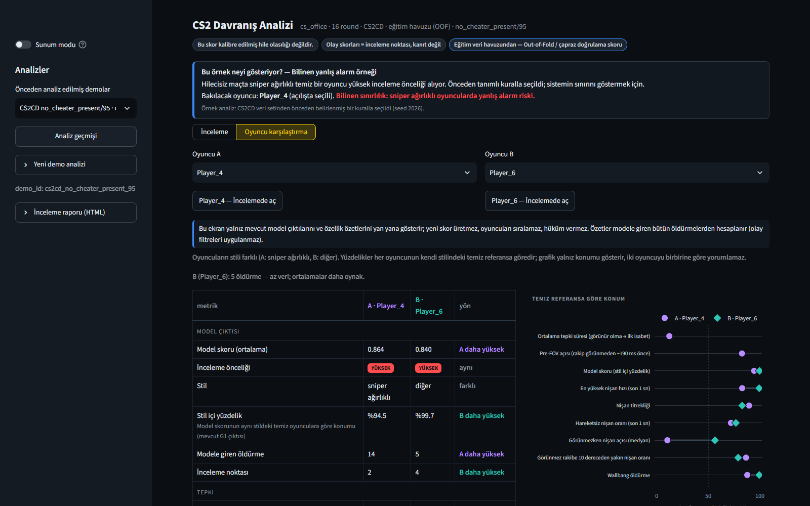
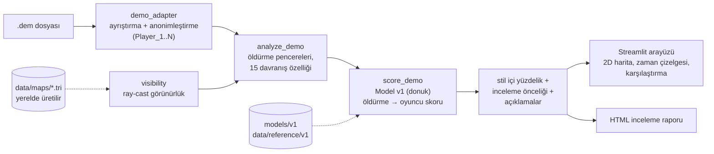

# CS2 Davranış Analizi

**Counter-Strike 2 maç demolarından oyuncu davranışını çıkaran ve hangi oyuncu/olaylara önce bakılabileceğini
sıralayan offline bir inceleme aracı.**

Geliştirici: Samet Tanış ([@samettns](https://github.com/samettns))

> [!IMPORTANT]
> **Bu araç bir hüküm aracı değildir.** Ürettiği skor **kalibre edilmiş bir hile olasılığı değildir**; sistem
> kimseyi otomatik olarak "hileci" ilan etmez, yalnızca bir insanın önce neye bakabileceğini sıralar.
> Çıktıları **başkalarını suçlamak veya ifşa etmek için tek başına kullanılmamalıdır.**
> Ayrıntı: [Sorumlu kullanım](#9-sorumlu-kullanım).

---

## 1. Proje amacı

Hile şüphesi çoğu zaman bir maçı baştan sona izleyerek incelenir; bu yavaş ve öznel bir süreçtir. Bu proje,
bir `.dem` dosyasından her oyuncunun **nişan hareketi, tepki süresi ve görünürlükle ilişkili davranışını**
ölçer ve iki şey üretir:

- **İnceleme önceliği** (yüksek / orta / düşük): oyuncunun skoru, aynı oyun stilindeki temiz oyunculara göre
  ne kadar sıra dışı?
- **İncelenecek anlar**: skorun yükseldiği öldürmeler, round/tick bilgisiyle ve 2D harita üzerinde.

Amaç bir insanın incelemesini hızlandırmaktır, onun yerine geçmek değil. Model, açık **CS2CD** veri setiyle
eğitildi.

**Bu sürüm hazır eğitilmiş Model v1 ile çıkarım (analiz) yapar.** Modeli eğiten ve değerlendiren tam araştırma
hattı (çift seçimi, çapraz doğrulama, dondurma, duyarlılık analizleri) bu public depoda **bulunmaz**. Modelin nasıl
eğitildiği ve değerlendirildiği [MODEL_CARD.md](MODEL_CARD.md) dosyasında özetlenmiştir.

## 2. Ekran görüntüleri

Görüntüler CS2CD örnek analizlerinden alınmıştır. Depoda Valve'a ait harita görseli bulunmadığı için harita zemini
boştur; kendi oyun kurulumunuzdan radar üretirseniz ([bölüm 6.3](#63-harita-dosyaları-kendi-cs2-kurulumunuzdan))
konumlar harita üzerinde görünür.





## 3. Mimari



| adım | modül | çıktı |
|---|---|---|
| Ayrıştırma | `src/demo_adapter.py` | CS2CD şemasında tick + olay tablosu; Steam ID → `Player_N`, isim sütunları atılır |
| Özellikler | `src/analyze_demo.py`, `src/aim.py`, `src/features.py` | `reports/analysis/<demo_id>/features.parquet`, `qc.json` |
| Görünürlük | `src/visibility.py`, `src/wallhack_features.py` | harita geometrisi üzerinde ışın izleme (ray-cast) ile "rakip görünür müydü?" |
| Skor | `src/score_demo.py` | `player_scores.parquet`, `event_scores.parquet`, `model_report.md` |
| Arayüz | `app/app.py`, `src/viewer_data.py`, `src/radar.py`, `src/playback.py` | 2D inceleme ekranı |
| Yükleme | `src/upload_flow.py` | arayüzden `.dem` yükleme; ayrı süreçte analiz |
| Rapor | `src/report_export.py` | tek dosyalık HTML inceleme raporu |

**Model v1.** `HistGradientBoostingClassifier`, her öldürmeyi 15 özellikle puanlar; oyuncu skoru, öldürme
skorlarının ortalamasıdır (en az 3 öldürme; azsa "yetersiz veri"). Model dondurulmuştur ve depoda hazır eğitilmiş
hâliyle bulunur (`models/v1/`). Ayrıntı: [MODEL_CARD.md](MODEL_CARD.md).

| grup | özellikler |
|---|---|
| nişan hareketi (öldürmeden önceki 1 sn) | ortalama / en yüksek / son 250 ms nişan hızı, titreklik, hareketsiz nişan oranı, dikey nişan aralığı, öldürme sonrası dönüş |
| atış ve silah | atış sayısı, sniper mı, tabanca mı |
| görünürlük | rakip görünmezken nişan açısı, görünmez rakibe yakın nişan oranı, rakip görünmeden hemen önceki nişan açısı, duvar arkasından isabet, tepki süresi (görünür olma → ilk isabet) |

**İnceleme önceliği.** Oyuncular stile göre üç gruba ayrılır (sniper ağırlıklı / otomatik ağırlıklı / diğer).
Silah türü davranışı çok etkilediği için skor, tek bir global eşikle değil **aynı stildeki temiz CS2CD
oyuncularıyla** karşılaştırılır:

- **yüksek:** skor, o stildeki temiz oyuncuların %95'lik diliminin üstünde (hedef: temiz oyuncuların ~%5'i)
- **orta:** %90'lık dilimin üstünde
- **düşük:** altında

**Değerlendirme.** CS2CD'de aynı harita, aynı mod ve benzer uzunlukta 50 eşleştirilmiş maç çiftinde, maç
bazında çapraz doğrulama ile oyuncu düzeyi AUC: nişan + silah özellikleri **0.813** [0.76–0.86], görünürlük
özellikleri eklenince **0.856** [0.81–0.90]. Bu sonuçlar bir **sinyal olduğunu gösterir, kanıt değildir**: veri
etiketleri gürültülüdür ve modelden bağımsız, hiç kullanılmamış bir test seti kalmamıştır
([sınırlılıklar](#8-bilinen-sınırlılıklar), [MODEL_CARD.md](MODEL_CARD.md)).

### Proje yapısı

| klasör | içerik |
|---|---|
| `app/` | Streamlit arayüzü |
| `src/` | veri hattı, model ve arayüz veri katmanı |
| `models/v1/` | dondurulmuş, hazır eğitilmiş Model v1 ([MODEL_CARD.md](MODEL_CARD.md)) |
| `data/reference/v1/` | eşikler, açıklama ve dağılım referansları |
| `samples/analysis/` | CS2CD'den türetilmiş anonim örnek analizler |
| `tests/` | `pytest` testleri |

## 4. Özellikler

- `.dem` dosyasını arayüzden yükleyip analiz etme (ayrı süreç, aşama aşama ilerleme, tek analiz kilidi)
- Oyuncu başına skor, stil içi yüzdelik ve inceleme önceliği; en belirleyici özelliklerin Türkçe açıklaması
- Round seçimi, olay zaman çizelgesi ve 2D harita üzerinde öldürme anları; **round oynatma**
- Çok katlı haritalarda (Nuke, Vertigo) kat ayrımı
- Oyuncu karşılaştırma ve olay filtreleri
- Demo düzeyi **dağılım uyarısı**: demo, modelin eğitildiği maçlardan çok farklıysa (ör. profesyonel maç) uyarır
- Tek dosyalık HTML inceleme raporu (gizlilik denetiminden geçmezse yazılmaz)
- Kurulumdan hemen sonra denenebilecek anonim örnek analizler

## 5. Kurulum

Gerekenler: **Windows 10/11**, **Python 3.12** (awpy, Python < 3.14 istiyor; 3.12 ile test edildi) ve git.

```powershell
git clone https://github.com/samettns/cs2-cheat-detector-public.git
cd cs2-cheat-detector-public
py -3.12 -m venv .venv
.venv\Scripts\python.exe -m pip install -r requirements-lock.txt
```

- `requirements-lock.txt` birebir sürümleri içerir (önerilen); `requirements.txt` yalnız doğrudan bağımlılıklardır.
- Kurulumu doğrulamak için: `.venv\Scripts\python.exe -m pytest tests`. Ham CS2CD verisi veya harita dosyası
  gerektiren testler kendiliğinden atlanır (`skipped`).

Arayüzü başlatma:

```powershell
.venv\Scripts\python.exe -m streamlit run app\app.py
```

Tarayıcıda `http://localhost:8501` açılır ve örnek analizler listelenir. Belirli bir analizi doğrudan açmak için
`http://localhost:8501/?demo=<demo_id>`.

## 6. `.dem` analizi

### 6.1 Arayüzden

Sol kenar çubuğu → **Yeni demo analizi** → kaynak seçin (`valve`, `faceit`, `hltv`, `other`) → `.dem` dosyasını
yükleyin (en çok ~1 GB) → **Analizi başlat**.

- Analiz demo başına birkaç dakika sürer (16 GB RAM'li bir dizüstünde ~6–9 dk). Aynı anda tek analiz yapılır.
- Başarıyla bitince **ham `.dem` ve kimlik eşlemesi silinir**; yalnız takma adlı analiz (`Player_1..10`) kalır.
  "Ham demoyu sakla" seçeneği varsayılan olarak kapalıdır. Hata olursa hiçbir şey silinmez.
- **Model skoru için haritanın `.tri` dosyası gerekir** ([6.3](#63-harita-dosyaları-kendi-cs2-kurulumunuzdan)).
  `.tri` yoksa analiz biter ama "Model v1 için uygun değil" der ve skor üretmez.
- Desteklenen haritalar: dust2, mirage, inferno, nuke, ancient, anubis, vertigo, train, office.

### 6.2 Komut satırından

```powershell
.venv\Scripts\python.exe src\analyze_demo.py <demo.dem> --source valve   # özellikler
.venv\Scripts\python.exe src\score_demo.py  <demo.dem> --source valve    # skorlar (özellikler yoksa önce onları üretir)
.venv\Scripts\python.exe src\report_export.py reports\analysis\<demo_id> # HTML inceleme raporu → reports/exports/
```

Çıktı: `reports/analysis/<demo_id>/` (`model_report.md` okunabilir rapor, `qc.md` kalite kontrolü). Bu klasörler
git'e girmez.

### 6.3 Harita dosyaları (kendi CS2 kurulumunuzdan)

Radar görselleri ve harita geometrisi **Valve'ın dosyalarıdır; bu depoda dağıtılmaz.** Kendi CS2 kurulumunuzdan
üretilir (`data/maps/`, git dışı):

| dosya | ne için | yoksa |
|---|---|---|
| `data/maps/radar/<harita>.png/.json` | 2D arayüzde harita görseli | arayüz boş zemin çizer |
| `data/maps/<harita>.tri` | ray-cast görünürlük | yeni demolarda skor üretilmez |

1. Counter-Strike 2'yi Steam'den kurun.
2. [Source2Viewer (ValveResourceFormat)](https://github.com/ValveResourceFormat/ValveResourceFormat/releases)
   sürümlerinden **Source2Viewer-CLI**'yi (Windows) indirip bir klasöre açın (geliştirmede 20.0 kullanıldı).
3. Üretin. Araç ve oyun yolları otomatik aranır; bulunamazsa ortam değişkeniyle verin:
   ```powershell
   $env:VRF_CLI = "<klasör>\Source2Viewer-CLI.exe"
   $env:CS2_CSGO_DIR = "<Steam kütüphanesi>\steamapps\common\Counter-Strike Global Offensive\game\csgo"
   .venv\Scripts\python.exe src\setup_maps.py build          # 9 harita; tek harita: build de_dust2
   .venv\Scripts\python.exe src\setup_maps.py check          # hangi dosyalar var
   ```
   Toplam ~1.7 GB disk gerekir; ağır haritalarda birkaç dakika sürebilir.

`.tri` dosyası oyunun o anki harita sürümünden üretilir; farklı bir oyun güncellemesi görünürlük değerlerini çok
az değiştirebilir.

## 7. Gizlilik

- **Her şey yerelde çalışır.** Demo veya sonuç hiçbir sunucuya gönderilmez (Streamlit kullanım istatistikleri kapalı).
- **Takma ad:** Steam ID'ler `Player_1..N` ile değiştirilir, isim sütunları atılır; yalnız iki takımdaki oyuncular
  tutulur (izleyici/yorumcu yok).
- **Takma ad tam anonimlik değildir.** `Player_N` sırası deterministiktir (oyuncunun ilk görüldüğü tick). Aynı
  demoya sahip biri oyuncuları gerçek kimliklere geri bağlayabilir. Bu yüzden başkalarının maçlarına ait analiz
  çıktılarını herkese açık paylaşmayın.
- **Silme:** başarılı yüklemeden sonra ham `.dem` ve kimlik eşlemesi silinir; analiz klasörleri git dışıdır.
- **Rapor denetimi:** HTML rapor, Steam ID / yerel dosya yolu gibi izler bulunursa yazılmaz.
- **Örnekler:** `samples/` yalnız CS2CD'den türetilmiş, veri setinde zaten anonim olan maçları içerir. Güncel
  (Valve / FACEIT / HLTV) demolardan türetilmiş hiçbir örnek depoda yoktur.
- **Geliştiriciler için:** `git config core.hooksPath .githooks` gizlilik kancasını açar. Kanca `.dem`, kimlik
  eşlemesi ve Steam ID içeren commit'leri engeller.

## 8. Bilinen sınırlılıklar

- **Skor kalibre edilmiş olasılık değildir;** güncel demolarda kalibrasyon doğrulanmadı.
- **Yüksek beceri yanlış pozitif riski:** model, çok yüksek becerili oyuncularda (ör. profesyonel maçlar;
  özellikle kısa tepki süresi) beceriyi hile benzeri davranıştan her zaman ayırt edemez ve bu oyunculara yüksek
  inceleme önceliği verebilir. Sistem CS2CD benzeri matchmaking maçları için kuruldu; demo bu maçlardan belirgin
  biçimde farklıysa arayüz demo düzeyinde bir dağılım uyarısı gösterir.
- **Sniper ağırlıklı oyuncularda** ayırt etme gücü düşük, yanlış alarm riski yüksek.
- **Etiket gürültüsü:** eğitim verisindeki hileci etiketleri oyuncu düzeyindedir ve gürültülüdür; hileli maçlarda
  çoğu zaman bütün takım etiketlidir.
- **Bağımsız test seti yok:** modelden tamamen bağımsız, hiç kullanılmamış bir değerlendirme seti kalmadı;
  yukarıdaki AUC değerleri iyimser olabilir.
- **Eğitim hattı yok:** bu depo modeli yeniden eğitmez; yalnız hazır Model v1 ile analiz yapar.
- **Kapsam:** 64 tick demolar, 9 harita. FACEIT/HLTV demolarında bazı isteğe bağlı olaylar yoktur (modele girmez).
  Maç öncesi (ısınma / bıçak roundu) öldürmeler modele alınmaz.
- **Model v1 donuktur;** yeni özellik veya eşik denemesi bu sürümde yapılmaz.

## 9. Sorumlu kullanım

- Skor **"bu oyuncunun hile yapma olasılığı" değildir.** Yalnızca oyuncunun davranışının, eğitim verisindeki temiz
  oyunculara göre ne kadar sıra dışı olduğunu sıralar.
- Sistem **otomatik hüküm vermez.** "Yüksek inceleme önceliği" bir insanın o anları izlemesi için öneridir.
- Yüksek beceri, alışılmadık oyun stili, ağ gecikmesi veya demo kayıt farklılıkları yüksek skor üretebilir.
- Bu araç **başkalarını suçlamak, ifşa etmek veya cezalandırmak için tek başına kullanılmamalıdır.** Çıktıları
  herhangi bir oyuncu hakkında kamuya açık bir iddianın dayanağı yapmayın. Resmî süreçler (ör. oyun içi
  raporlama) için bile tek kanıt olarak kullanılmamalıdır.

## 10. Lisans ve veri atfı

- **Kod:** [MIT](LICENSE), © 2026 samettns (`app/`, `src/`, `tests/`, araçlar ve yapılandırma dosyaları).
- **CS2CD'den türetilen dosyalar** koddan ayrı değerlendirilir: `data/pairs*.csv`, `data/reference/v1/`,
  `models/v1/`, `samples/analysis/` — **CC-BY-4.0**, CS2CD'ye atıfla. Dosya bazında değerlendirme, atıf metni ve
  değişiklik bildirimi: [DATA_ATTRIBUTION.md](DATA_ATTRIBUTION.md).
  Kaynak: CS2CD — *Counter-Strike 2 Cheat Detection* veri seti, Hugging Face
  [`CS2CD/CS2CD.Counter-Strike_2_Cheat_Detection`](https://huggingface.co/datasets/CS2CD/CS2CD.Counter-Strike_2_Cheat_Detection),
  doi:10.57967/hf/5654, lisans [CC-BY-4.0](https://creativecommons.org/licenses/by/4.0/). Ham CS2CD verisi bu
  depoda yoktur.
- **Valve dosyaları:** harita geometrisi ve radar görselleri depoda yoktur; kullanıcının kendi oyun kurulumundan
  yerelde üretilir. Bu proje Valve Corporation ile bağlantılı değildir ve Valve tarafından onaylanmamıştır.
  Counter-Strike, Valve Corporation'ın ticari markasıdır.

## Yapay zekâ kullanım beyanı

Bu projenin geliştirme sürecinde yapay zekâ destekli araçlardan yardım alınmıştır: **Claude Code** (Anthropic) kod
yazma, test ve dokümantasyonda; **ChatGPT** (OpenAI) fikir tartışması, planlama ve gözden geçirmede. Bu araçlar
projenin sahibi, geliştiricisi veya ortak yazarı değildir. Tasarım, entegrasyon, test, değerlendirme ve nihai
kararların sorumluluğu geliştiriciye aittir.
